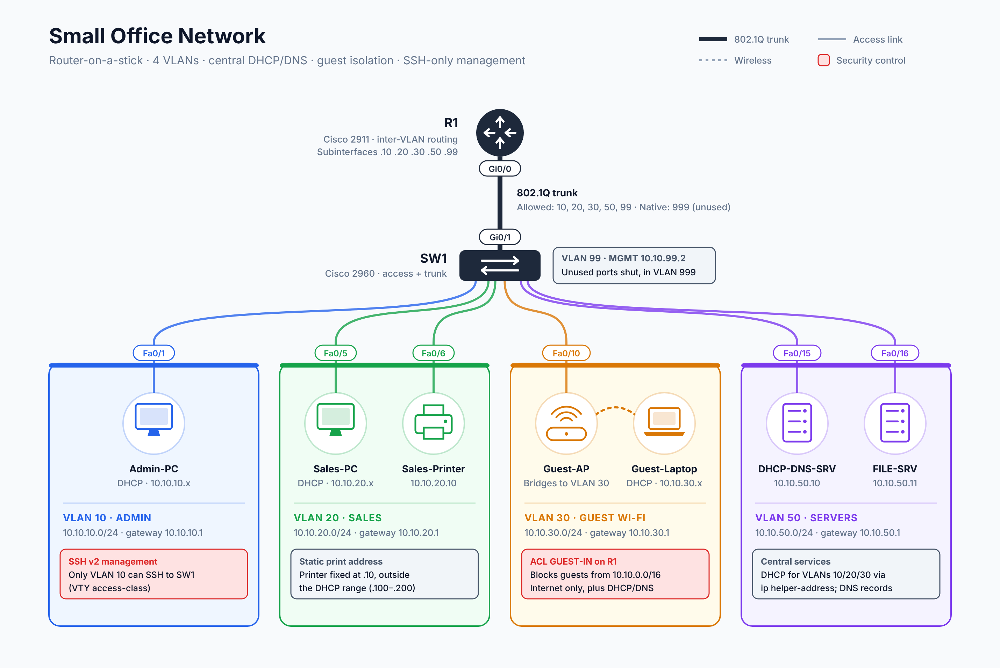
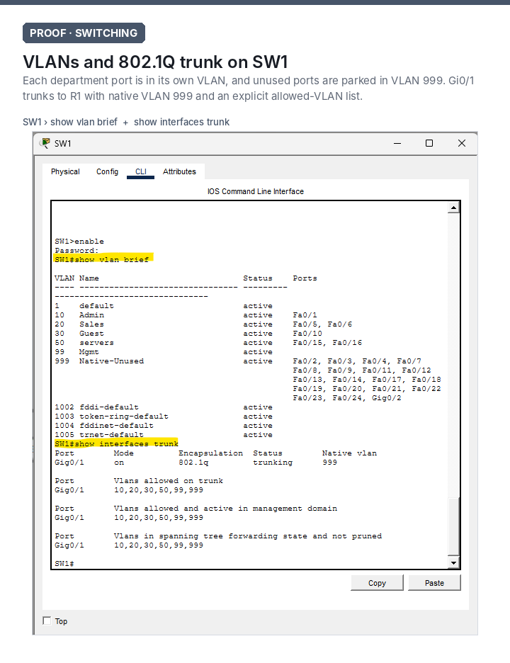
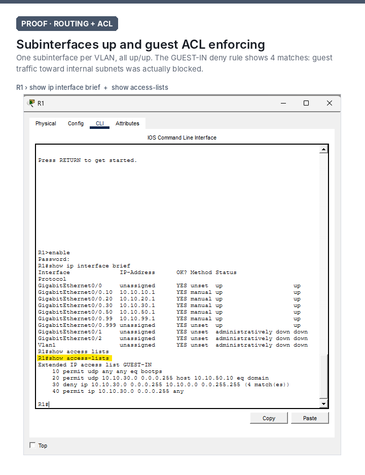
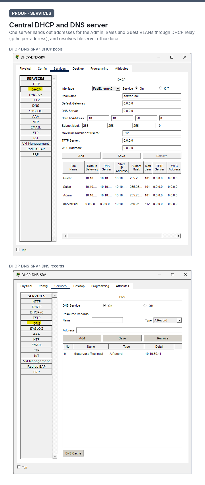
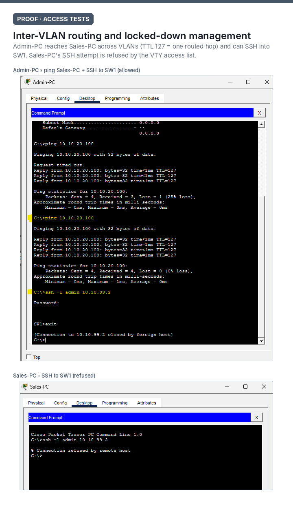

# Small Office Network Lab

**Segmented VLAN network with central DHCP/DNS, guest Wi-Fi isolation, and locked-down switch management, built and tested in Cisco Packet Tracer.**



`VLANs` `802.1Q trunking` `Router-on-a-stick` `DHCP relay` `DNS` `Extended ACLs` `SSH hardening` `Troubleshooting`

---

## The scenario

A small office with Admin and Sales departments needs:

- **Separate networks for each department**, so a problem or compromise in one doesn't spread to the other
- **Guest Wi-Fi** that gets internet access but **can't reach any internal device**
- **One central server** handing out IP addresses and resolving names for every department
- **Secure switch management** that only IT (Admin) can reach

All of this has to run on one router and one switch.

## Design

| Decision | Why |
|---|---|
| **Router-on-a-stick**: one router port carries every VLAN over an 802.1Q trunk, using one subinterface per VLAN | Inter-VLAN routing with a single router and switch. This is the low-cost option for a small office. |
| **Central DHCP server** reached through `ip helper-address` on each subinterface | One place to manage addressing, the same way enterprise networks do it, instead of running DHCP on the router |
| **Reserved static range (.2–.20)** in each subnet | Printers and servers keep predictable addresses outside the DHCP pool (.100–.200) |
| **Dedicated management VLAN (99)** | Switch management traffic is kept separate from user traffic |

### Addressing

| VLAN | Name | Subnet | Gateway | Addressing |
|---|---|---|---|---|
| 10 | Admin | 10.10.10.0/24 | 10.10.10.1 | DHCP .100–.200 |
| 20 | Sales | 10.10.20.0/24 | 10.10.20.1 | DHCP .100–.200 |
| 30 | Guest | 10.10.30.0/24 | 10.10.30.1 | DHCP .100–.200 |
| 50 | Servers | 10.10.50.0/24 | 10.10.50.1 | Static |
| 99 | Mgmt | 10.10.99.0/24 | 10.10.99.1 | Static (SW1 = .2) |
| 999 | Native-Unused | none | none | Black-hole VLAN |

| Device | SW1 port | VLAN | Address |
|---|---|---|---|
| R1 (Cisco 2911) | Gi0/1 (trunk) | 10, 20, 30, 50, 99 | .1 on each subnet |
| Admin-PC | Fa0/1 | 10 | DHCP |
| Sales-PC | Fa0/5 | 20 | DHCP |
| Sales-Printer | Fa0/6 | 20 | 10.10.20.10 |
| Guest-AP → Guest-Laptop (wireless) | Fa0/10 | 30 | DHCP |
| DHCP-DNS-SRV | Fa0/15 | 50 | 10.10.50.10 |
| FILE-SRV | Fa0/16 | 50 | 10.10.50.11 |

## Security

**Guest isolation:** an extended ACL is applied inbound on R1's guest subinterface:

```
ip access-list extended GUEST-IN
 permit udp any any eq bootps                                     ! let guests get an IP
 permit udp 10.10.30.0 0.0.0.255 host 10.10.50.10 eq domain       ! allow DNS lookups only
 deny   ip  10.10.30.0 0.0.0.255 10.10.0.0 0.0.255.255            ! block every internal subnet
 permit ip  10.10.30.0 0.0.0.255 any                              ! everything else (internet)
```

**Management lockdown on SW1:**
- SSH v2 only (`transport input ssh`), with Telnet disabled
- Local user login
- The VTY lines accept connections **only from the Admin VLAN** (`access-class 10 in`)

**Switch hardening:**
- Native VLAN moved from 1 to an unused VLAN (999), which blocks VLAN-hopping attacks
- Trunk negotiation disabled (`switchport nonegotiate`) and an explicit allowed-VLAN list on the trunk
- Every unused port shut down and parked in VLAN 999

## Verification

| # | Test | Expected | Result |
|---|---|---|---|
| 1 | Admin-PC pings Sales-PC | Success across VLANs | ✅ Replies with TTL 127, one routed hop through R1 |
| 2 | PCs request addresses on DHCP | Lease from the correct VLAN pool | ✅ 10.10.10.x / 10.10.20.x / 10.10.30.x |
| 3 | Trunk carries the right VLANs | 10, 20, 30, 50, 99 allowed, native 999 | ✅ `show interfaces trunk` |
| 4 | Guest tries to reach the internal network | Blocked | ✅ The ACL deny rule logged 4 matches |
| 5 | Admin-PC SSHes to SW1 | Allowed | ✅ Reached the `SW1>` prompt |
| 6 | Sales-PC SSHes to SW1 | Refused | ✅ "Connection refused by remote host" |

<details markdown="1">
<summary><b>Show the evidence screenshots</b></summary>






</details>

## Troubleshooting scenario

To show how I work a ticket, I broke the network on purpose and fixed it:

> **"Sales user can't print."** The PC had a 169.254.x.x address. I traced it to switch port Fa0/5 being assigned to the wrong VLAN, moved it back, and confirmed the user could print again.

**[Read the full troubleshooting write-up →](TROUBLESHOOTING.md)**

## Repo contents

| File | What it is |
|---|---|
| `SmallOfficeNetwork.pkt` | The Packet Tracer lab. Open it in Cisco Packet Tracer. |
| `R1-config.txt` / `SW1-config.txt` | Full running configs |
| `TROUBLESHOOTING.md` | Break/fix case study |
| `screenshots/` | Topology diagram (PNG + editable SVG) and test evidence |

> Passwords in this lab are demo values for a simulated environment and aren't used anywhere real.

## What's next

**Part 2: extend this office to Azure.** I'll build a virtual network with subnets and network security groups that mirror these VLAN rules, add a VM reached only through Azure Bastion, and design the site-to-site VPN that would connect it back to the office.

---

**Latoyya Smith** · CompTIA A+ · Network+ · [latoyyasmith.com](https://latoyyasmith.com)
