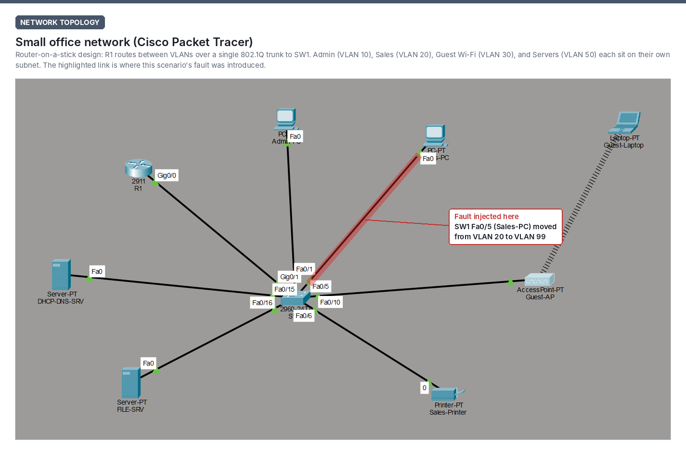
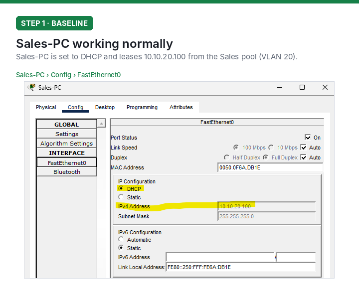
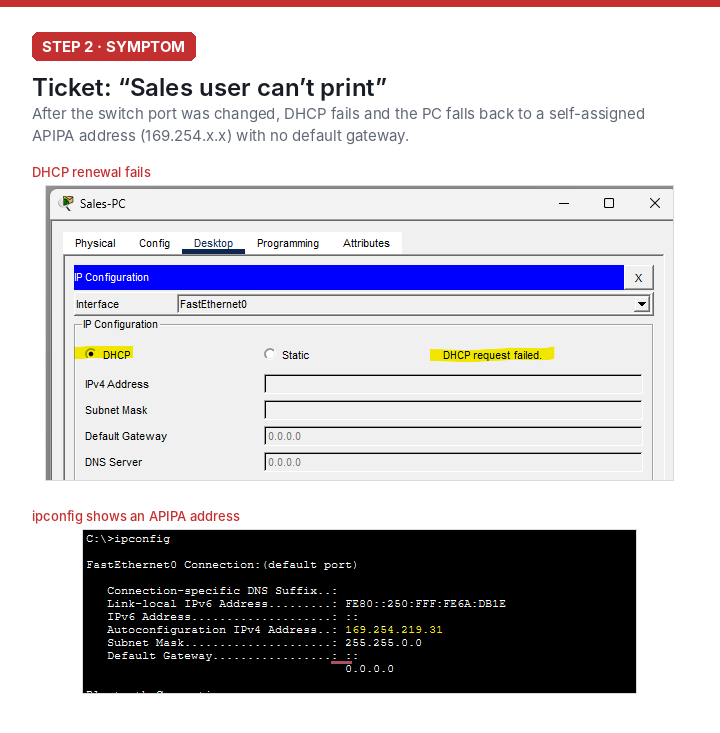
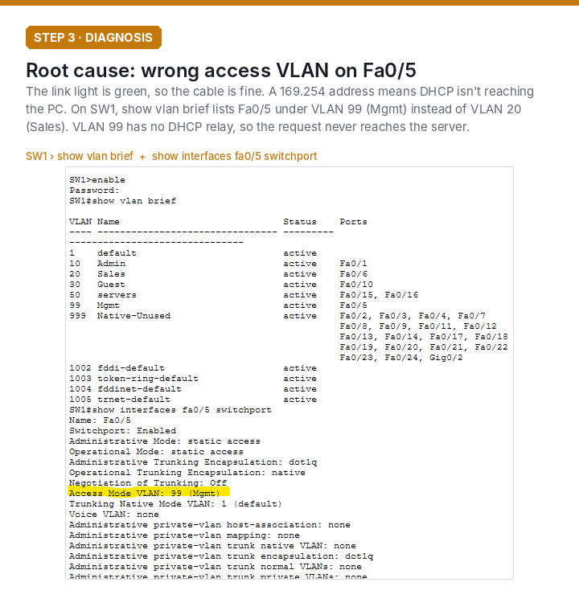
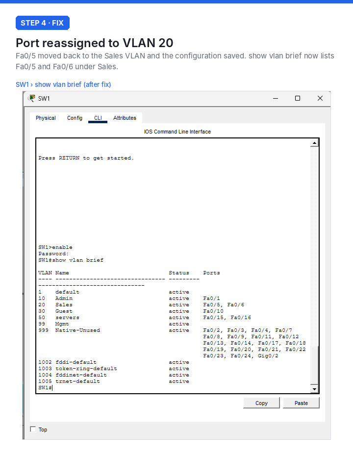
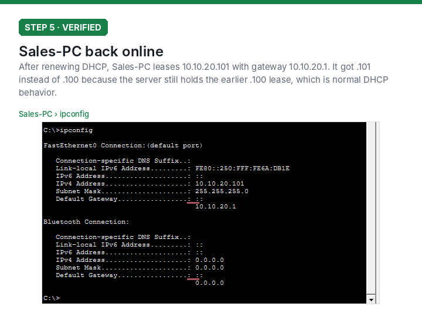
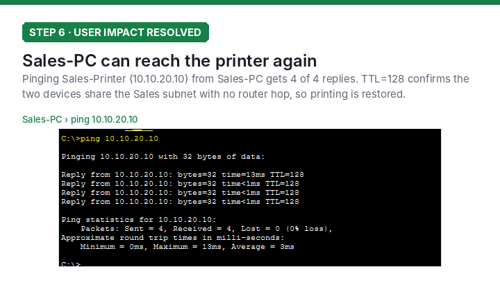

# Troubleshooting Scenario: Sales PC Can't Print

A simulated help desk ticket on the small office network. I misconfigured one switch port on purpose, then diagnosed and fixed it the way I would a real ticket.

## Summary

| | |
|---|---|
| **Symptom** | Sales user couldn't print. The PC had a 169.254.x.x (APIPA) address and no default gateway. |
| **Root cause** | Switch port Fa0/5 was assigned to VLAN 99 (Mgmt) instead of VLAN 20 (Sales). |
| **Fix** | Reassigned Fa0/5 to VLAN 20 and renewed the PC's DHCP lease. |
| **Prevention** | Added interface descriptions so port assignments are easy to verify at a glance. |

---

## Network at a glance



| Device | SW1 port | VLAN | Address |
|---|---|---|---|
| R1 (router) | Gi0/1 (trunk) | 10, 20, 30, 50, 99 | .1 gateway on each subnet |
| Admin-PC | Fa0/1 | 10 Admin | DHCP (10.10.10.x) |
| **Sales-PC** | **Fa0/5** | **20 Sales** | **DHCP (10.10.20.x)** |
| Sales-Printer | Fa0/6 | 20 Sales | 10.10.20.10 (static) |
| Guest-AP / Guest-Laptop | Fa0/10 | 30 Guest | DHCP (10.10.30.x) |
| DHCP-DNS-SRV | Fa0/15 | 50 Servers | 10.10.50.10 (static) |
| FILE-SRV | Fa0/16 | 50 Servers | 10.10.50.11 (static) |
| SW1 management | n/a | 99 Mgmt | 10.10.99.2 |

## 1. Baseline

Sales-PC is on DHCP and leases `10.10.20.100` from the Sales pool.



## 2. The break and the symptom

The fault was introduced on the switch, not the PC. From the user's side, nothing changed:

```
SW1(config)# interface fa0/5
SW1(config-if)# switchport access vlan 99
```

When the PC renewed its lease, the DHCP request failed and the PC assigned itself an APIPA address. With no gateway, it can't reach the printer or anything else.



## 3. Diagnosis

I worked from the bottom of the OSI model up:

1. **Physical (Layer 1):** The link light was green, so the cable and port were up.
2. **Addressing:** A `169.254.x.x` address means the DHCP request never got an answer.
3. **Switching (Layer 2):** `show vlan brief` on SW1 listed **Fa0/5 under VLAN 99 (Mgmt)**, not VLAN 20 (Sales). `show interfaces fa0/5 switchport` confirmed `Access Mode VLAN: 99`.

VLAN 99 has no `ip helper-address` on the router, so DHCP broadcasts from that VLAN are never relayed to the DHCP server at 10.10.50.10.



## 4. Fix

```
SW1(config)# interface fa0/5
SW1(config-if)# switchport access vlan 20
SW1(config-if)# description Sales-PC
SW1(config-if)# end
SW1# write memory
```



## 5. Verification

After renewing DHCP, Sales-PC leased `10.10.20.101` with gateway `10.10.20.1`. It got `.101` instead of `.100` because the DHCP server was still holding the earlier lease, which is expected behavior.



Then I confirmed the fix from the user's side by pinging the printer the ticket was about.



## What this shows

- **Read the clue the symptom gives you.** An APIPA address narrows the problem to "DHCP isn't arriving" before you touch any equipment.
- **Check layer by layer** instead of guessing: cable, then addressing, then VLAN.
- **Confirm the fix from the user's side**, not just the switch's.
- **Prevent the repeat:** port descriptions make a wrong VLAN easy to spot during the next audit.
